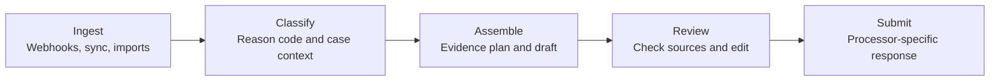
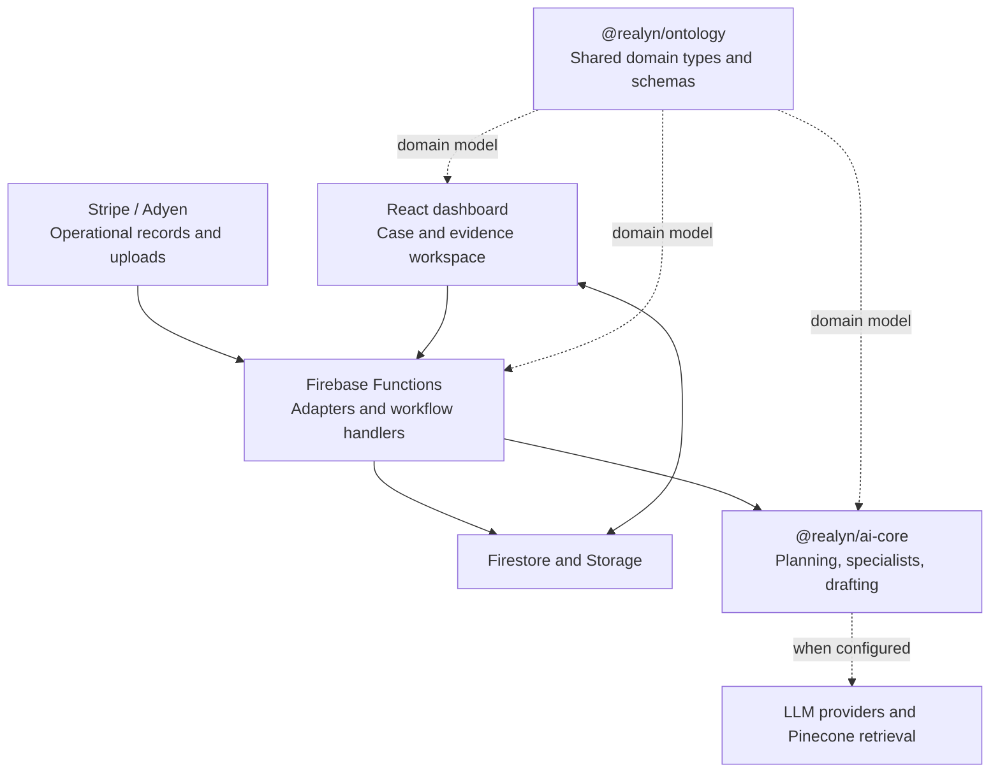

<p align="center">
  <picture>
    <source media="(prefers-color-scheme: dark)" srcset="assets/brand/realyn_wordmark_white.png" />
    
  </picture>
</p>

<h1 align="center">Realyn</h1>
<p align="center">A side project exploring payment disputes, evidence workflows, and AI-assisted drafting.</p>
<p align="center">
  <a href="#workflow">Workflow</a> ·
  <a href="#ontology">Ontology</a> ·
  <a href="#architecture">Architecture</a> ·
  <a href="#getting-started">Run locally</a> ·
  <a href="docs/PROJECT_STATUS.md">Project status</a> ·
  <a href="#inside-the-repo">Code map</a> ·
  <a href="CONTRIBUTING.md">Contributing</a>
</p>

## About

Realyn explores a practical question: can payment disputes, booking records, and supporting documents be brought into one workspace to make preparing a response easier?

The project combines a React dashboard, Firebase backend, and a separate TypeScript AI package. Hospitality and ticketing provide the main example workflows. It has grown to include processor adapters, evidence planning, response drafting, and demo datasets.

**Status: experimental side project.** The repository contains implementation work and tests; that does not establish production readiness, processor certification, compliance, or improved dispute outcomes. AI output needs human review, and integration behavior depends on configuration and external services.

## What you can explore

- **Dispute workspace:** browse cases, inspect evidence requirements, upload supporting files, and work through response preparation.
- **AI experiments:** evidence planning, specialist analysis, and argument drafting, with OpenAI and Anthropic provider implementations.
- **Payment integrations:** Stripe and Adyen webhook, sync, mapping, and submission code. Other processors are extension ideas.
- **Operational context:** Opera Cloud integration code, import parsers, and hospitality/ticketing examples.
- **Shared domain models:** TypeScript schemas for disputes, evidence, organizations, and audit events.

Retrieval, embeddings, and reranking code also live in the AI package. These need configuration, reference content, and evaluation; their presence does not mean every draft uses retrieved sources. See [project status](docs/PROJECT_STATUS.md) for the boundaries and source links.

## Workflow

The workflow being explored is **ingest → classify → assemble → review → submit**: bring a dispute into the workspace, understand what evidence it needs, and prepare a response someone can inspect before sending.



1. **Ingest:** processor adapters and import paths bring payment and operational records into the backend.
2. **Classify:** reason-code mappings and hospitality or ticketing configurations help determine relevant evidence requirements.
3. **Assemble:** combine available records and uploaded documents with AI-assisted planning and drafting. Retrieval can add reference context when configured.
4. **Review:** inspect the evidence, correct the draft, and decide how to respond. AI suggestions are starting points for this work.
5. **Submit:** Stripe and Adyen handlers map responses to processor APIs; successful submission is separate from the eventual dispute outcome.

This describes the intended flow through the project. How much is automated depends on the integration and configuration; it is not a claim that every path has been validated end to end.

## Ontology

The architectural idea behind Realyn is to give the workflow a shared vocabulary. A processor dispute, a booking record, an evidence item, and a drafted argument describe different parts of the same case. **`@realyn/ontology` defines the TypeScript types and Zod schemas intended to connect those parts.**

- **Disputes and organizations** describe the case and its ownership.
- **Evidence requirements, items, and plans** describe what is needed and what has been collected.
- **Arguments and versions** represent the response being prepared.
- **Audit events and outcomes** provide shapes for recording actions and results.
- **Tenant context** models the organization, user, sandbox/live mode, vertical, locale, and request context.

The package also defines a canonical workflow status enum, alongside the older status fields still used by existing code. The ontology is a work in progress: some newer schemas are strict, existing document schemas remain permissive, and adoption across handlers is incremental.

Explore the [ontology source](packages/ontology/src/index.ts), [design rationale](docs/adr/0001-ontology.md), and [versioning and migration policy](docs/adr/0002-ontology-versioning.md).

## Architecture



The separation is the interesting experiment: adapters handle external formats, the ontology describes the domain, and the AI package focuses on planning and drafting. Dashed ontology links show the architectural role of the shared model; migration to it is still underway. Firebase Auth handles dashboard authentication.

## Getting started

The dashboard with Firebase emulators is the recommended starting point. Setup currently requires some configuration; this is not a one-command demo.

### Prerequisites

- Node.js 20.19+ and npm compatible with the root `packageManager` field.
- Java 17+ for the Firestore emulator.
- Firebase CLI available as `firebase`.

### 1. Install and build the backend

`functions/` is outside the npm workspace and needs its own install. Build `ai-core` first because Functions resolves its compiled exports.

```bash
git clone https://github.com/tstoko/realyn-app.git
cd realyn-app
npm ci
npm run build --workspace=@realyn/ai-core
npm ci --prefix functions
npm run build --prefix functions
npm run setup:dashboard:emulator
```

### 2. Configure the dashboard

The setup script creates `packages/dashboard/.env.local` from [the emulator template](packages/dashboard/.env.emulator). It leaves an existing file untouched.

Fill in the empty `VITE_FIREBASE_*` values using your Firebase web-app configuration. The shared Firebase initializer requires nonempty values even when using emulators. Keep:

```dotenv
VITE_USE_FIREBASE_EMULATORS=true
VITE_FIREBASE_FUNCTIONS_URL=http://127.0.0.1:5001/realyn-app/us-central1
VITE_FIREBASE_PROJECT_ID=realyn-app
```

The project ID must match across the dashboard, CLI, Functions URL, and seed scripts. The commands below use the repository's existing `realyn-app` ID with local emulators.

### 3. Start the emulators and dashboard

In one terminal, from the repository root:

```bash
firebase emulators:start --project realyn-app --export-on-exit=./emulator-data
```

In a second terminal:

```bash
npm run dev:dashboard
```

In a third terminal, after the emulators have started:

```bash
npm run seed:dice:emulator
```

Open the dashboard at **http://localhost:3001** and the Emulator UI at **http://127.0.0.1:4000**. Demo credentials are in [diceDemoConstants.ts](functions/src/lib/diceDemoConstants.ts). Named demo datasets are fixtures, not evidence of customer relationships or endorsements.

To restore a previous emulator session, add `--import=./emulator-data` to the emulator command.

AI calls and processor submissions are separate from the local UI setup. They require provider credentials and, for retrieval, a populated Pinecone index. Firebase emulators do not emulate these third-party APIs. Start with fixtures and processor test credentials; keep secrets out of commits.

### Troubleshooting

- **Missing Firebase env var:** complete `packages/dashboard/.env.local` and restart Vite.
- **Login fails:** seed the running emulators and use credentials for that dataset.
- **401 from Functions:** check that the Functions URL is local and that Auth, Firestore, and Functions started together.
- **Java path error:** the root `dev:emulators` shortcuts hard-code a Homebrew Java path. The direct Firebase command above uses your shell's Java installation.
- **Missing AI package exports:** rebuild `@realyn/ai-core` before building or checking Functions.

## Inside the repo

```text
packages/
  dashboard/    React 19, TypeScript, Vite, Tailwind; case and evidence UI
  ai-core/      LLM providers, specialists, retrieval, and vertical examples
  ontology/     Shared domain schemas
  shared/       Shared types, Firebase setup, and UI utilities
  website/      Earlier product website and marketing experiments
functions/      Firebase handlers, adapters, persistence, and tests
docs/           Setup notes, design decisions, and evaluation records
```

The dashboard talks to Firebase Auth, Firestore, Storage, and HTTP Functions. Functions handles backend workflows and calls `@realyn/ai-core` for portable AI logic. External processor, LLM, and retrieval services are configured separately.

Useful places to start:

- [Domain model design](docs/adr/0001-ontology.md)
- [AI services](docs/architecture/ai-services.md)
- [AI evaluation workflow](docs/eval/README.md)
- [Stripe submission testing](docs/integrations/stripe/STRIPE_SUBMISSION_TESTING.md)
- [Adyen test setup](docs/integrations/adyen/ADYEN_TEST_SETUP_GUIDE.md)

## Development checks

Run these from the repository root after installing both dependency sets:

```bash
npm run build --workspace=@realyn/ai-core
npm run typecheck --workspace=@realyn/ai-core
npm run typecheck --workspace=@realyn/dashboard
(cd functions && npx tsc --noEmit)

npm test --workspace=@realyn/ai-core
npm test --workspace=@realyn/dashboard
npm test --prefix functions
npm run lint --prefix functions
npm run build:dashboard
```

[CI](.github/workflows/ci.yml) runs Functions tests/lint/typechecking, dashboard tests/typechecking, and AI package typechecking. Passing those checks does not validate live integrations or AI quality.

## Next things to improve

- Make a fresh local demo easier to start and reproduce.
- Compare AI outputs on fixed, synthetic cases and record failures as well as improvements.
- Document which integration paths have been exercised in test environments.
- Keep the website and older planning documents consistent with the project's current scope.

See [contributing](CONTRIBUTING.md) for focused ways to help and [project status](docs/PROJECT_STATUS.md) for current limitations. Older commercial plans and website copy remain in the repository as historical context; they are not commitments about this side project.

